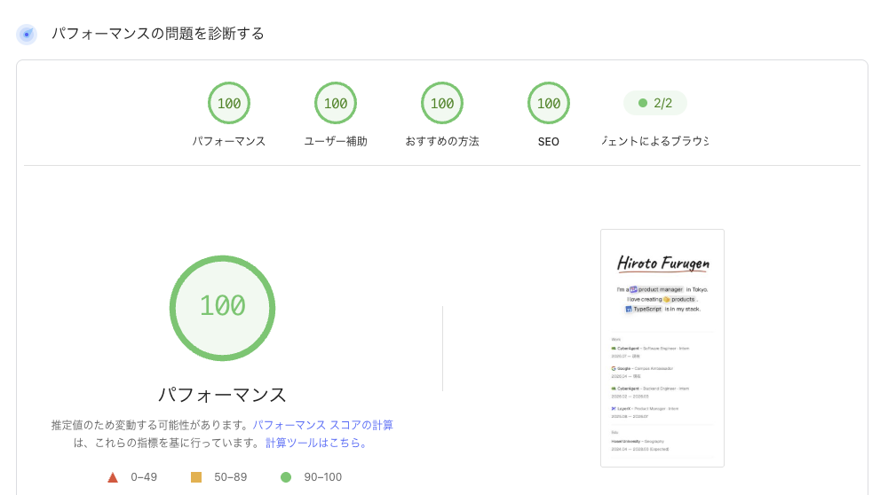

[前回の記事](/blog/back-to-markdown)では、このサイトを4か月で4回作り直し、Markdownに戻ってきた経緯を書きました。今回は、落ち着いた今の構成をまとめます。

## 全体像

サイトはAstroで静的なHTMLとして作り、Vercelから配信しています。リクエストのたびにサーバーで動く処理はありません。

| 役割 | 使っているもの |
| --- | --- |
| フレームワーク | Astro（静的生成） |
| 記事 | Markdown（Gitで管理） |
| OGP画像 | satori、resvg（ビルド時に生成） |
| 配信 | Vercel |
| チェック | GitHub Actions（lintとbuild）、Cursor Bugbot（レビュー） |
| 計測 | Vercel Analytics、Speed Insights、Google Analytics |

本番の依存パッケージは7つで、そのうち3つはフォントです。

## 記事の仕組み

記事は`src/content/blog/`にMarkdownで置き、ファイル名がそのままURLになります。この記事なら`portfolio-stack.md`が`/blog/portfolio-stack`です。ファイルの先頭には、次のような項目を書きます。

```md
---
title: ポートフォリオStackについて
description: 記事の冒頭やSNSでの共有に使う概要
date: 2026-11-12
tags: [astro, vercel]
---
```

これらの項目はスキーマで検証していて、日付の書き間違いや必須の項目の抜けがあるとビルドが失敗します。ファイル名にURLに使えない文字が入っている場合も同じです。

画像は記事と同じ場所に置き、相対パスで参照するとビルド時に最適化されます。コードのハイライトはShikiで行い、色はサイトのCSS変数に合わせています。

記事の取得は`src/feature/posts/`にまとめ、手順（service）、読み取り（repository）、型とルール（domain）の3つのファイルに分けています。ページはserviceだけを呼ぶので、記事の扱いを変えるときに見る場所が1か所で済みます。

## 表示の速さ

PageSpeed Insightsで測ると、4つの項目がすべて100になりました。



そのためにしていることは、どれも「読み込むものを減らす」ことです。

- **CSSはHTMLに埋め込む**：別ファイルのCSSを待たずに表示を始められます。Honoで作っていたころ、CSSが増えて最初の表示が遅くなったことがあるので、CSSの量と読み込み方には気をつけています
- **CSSは部品ごとに書く**：トップのヒーローや記事の一覧、フッターなどの部品が、それぞれ自分のスタイルを持っています。各ページには、そのページで使う部品の分だけが入り、1ページあたり約4〜11KBです
- **JavaScriptはほぼ使わない**：自前のスクリプトは、トップの文言を切り替える約0.8KBだけです。動きを減らす設定の端末では止まります。ほかは計測用のスクリプトです
- **配色は端末の設定に従う**：ライトとダークはCSSだけで切り替えていて、切り替えボタンは置いていません
- **フォントは必要な分だけ**：トップの名前に使っている手書き風のフォントは、名前の文字だけを含むファイルにして、先に読み込んでいます

## OGP画像

SNSで共有したときに出るOGP画像も、ビルド時に記事ごとに作っています。satoriでHTMLのような部品の組み合わせからSVGを作り、resvgでPNGに変換します。配信時に画像を作る処理はありません。

文字はInterとNoto Sans JPで、名前だけはトップと同じ手書き風のフォントです。背景には都道府県の風景をぼかした写真を47枚用意していて、記事のURLから毎回同じ1枚が選ばれます。

作っていて、2つつまずきました。1つは、余白の指定が画像の高さに足されて、名前が下にはみ出していたことです。要素の大きさの数え方（`box-sizing`）を直して解決しました。もう1つは、satoriがWOFF2形式のフォントを読めないことです。サイトで使っているフォントをそのまま渡せないので、WOFF形式に変換して使っています。

## おわりに

フレームワーク、記事、配信、チェックまで、どれも小さく保つことを優先しています。

次は、OGP画像の背景に都道府県の写真を使った理由を書くつもりです。
